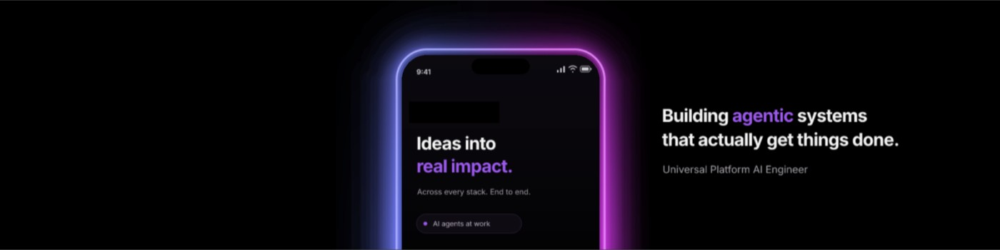

  

  <h1>Hi, I'm Mohini Chauhan.</h1>
  
<strong>Building products—and better ways to build it.</strong>

  

    Software Engineer at
    
  

---

### About me

I enjoy building products and figuring out how to make the engineering behind them better. At Microsoft, I'm developing **reusable AI agentic workflows** for cloud-native engineering on Azure. What interests me is the work around the model: giving it useful context, checking the results, and learning from the attempts that don't work.

Outside work, I spend many weekends building **cross-platform business apps for web, iOS, and Android**. I like being involved from the first "what problem are we solving?" through the UX, architecture, and the details that matter when someone actually uses the product. That's the mix I enjoy: building something useful and finding a better way to build the next thing.

### My toolkit

---

### Let's connect

If you're a fellow platform developer or work in tech, let's connect for a chit-chat!

[LinkedIn](https://www.linkedin.com/in/chauhan-mohini)
